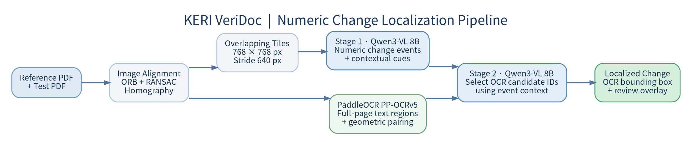
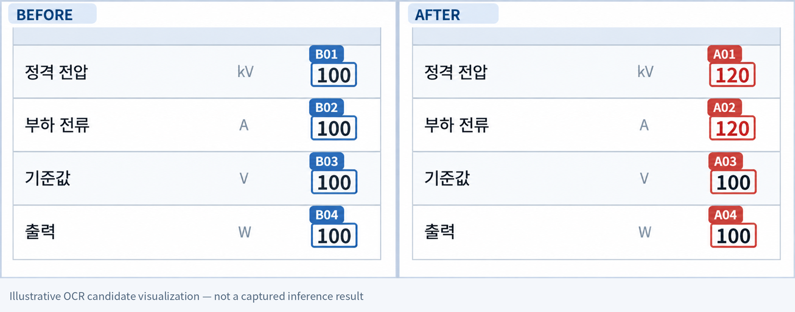
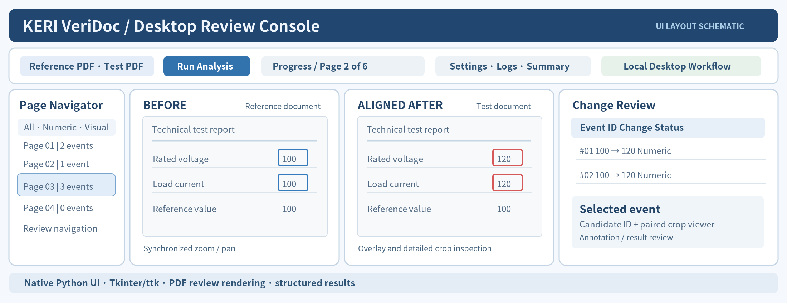

# KSMA Paper · KERI VeriDoc

### VLM-Guided OCR Candidate Selection for Numeric Change Localization

**Localizing numeric changes in technical documents through contextual VLM reasoning and OCR-grounded candidate selection.**

[한국어](README.md) · [Research summary](paper/README.md) · [Architecture](docs/ARCHITECTURE.md) · [Evaluation](docs/EVALUATION.md) · [Desktop GUI](docs/GUI.md)

`Python` · `Qwen3-VL 8B Instruct` · `PaddleOCR / PP-OCRv5` · `OpenCV` · `Tkinter / ttk`

| Precision | Recall | Precision gain over OCR Only |
|:---:|:---:|:---:|
| **90.5%** | **100.0%** | **+66.2 percentage points** |

*Reported localization results on six controlled synthetic document pairs containing 19 numeric changes. The gain is calculated from the reported 90.5% and 24.3% precision values.*

## Overview

Technical documents can contain repeated values and even repeated transitions such as `100 → 120` in different fields. Finding the changed value is only part of the task: the system must associate each event with its corresponding text region.

**KERI VeriDoc** separates semantic interpretation from geometric localization. A first-stage VLM extracts change events and contextual cues. OCR provides detected text regions with candidate IDs. A second-stage VLM selects the matching IDs, and the selected OCR boxes determine the final coordinates.

## Engineering Contributions

- **Two-stage reasoning:** separate change extraction from candidate selection.
- **Geometry-grounded output:** derive final bounding boxes from OCR detections.
- **Contextual disambiguation:** distinguish repeated transitions using nearby labels, units, and spatial cues.
- **Aligned local comparison:** ORB/RANSAC homography and overlapping tiles provide corresponding image regions.
- **Human review workflow:** a related desktop prototype offers synchronized document views, event inspection, overlays, and paired crop previews.

## Architecture

1. Render and align reference/test documents with ORB features and RANSAC homography.
2. Extract 768 × 768 px tiles with a 640 px stride and 128 px overlap.
3. Use Stage-1 Qwen3-VL 8B Instruct to extract changed values and contextual cues.
4. Apply PaddleOCR PP-OCRv5 to full pages and pair candidate text regions geometrically.
5. Use Stage-2 VLM to select candidate IDs from event context and annotated images.
6. Retrieve the selected OCR coordinates as the final localization output.

The evaluated configuration uses 300 DPI rendering and 24 paired tile positions per page. OCR contributes text-region geometry; OCR-recognized strings are not supplied as the VLM's final decision input.

[Detailed architecture →](docs/ARCHITECTURE.md)

## Candidate Selection

*Illustration of the candidate-selection principle.*

Two occurrences of the same numeric transition can correspond to different fields. Contextual event descriptions connect each occurrence to its own OCR candidate pair.

## Reported Results

| Setting or metric | Result |
|---|---|
| Dataset | 6 synthetic document pairs |
| Modified / unchanged pairs | 4 / 2 |
| Ground-truth numeric changes | 19 |
| Proposed precision / recall | **90.5% / 100.0%** |
| OCR Only precision / recall | 24.3% / 89.5% |
| Precision / recall gains | **+66.2 / +10.5 percentage points** |

These are results reported in the supplied research materials for **text-region localization** on the stated evaluation set. Full comparisons and metric definitions are in [EVALUATION.md](docs/EVALUATION.md).

## Desktop Review Interface

The related Tkinter/ttk desktop prototype supports:

- Reference/test PDF selection and analysis controls.
- Run and page navigation with Numeric / Visual filters.
- Synchronized BEFORE / ALIGNED AFTER viewers.
- Bounding-box overlays and per-event explanations.
- Paired crop inspection and JSON review annotations.

*The image is a layout schematic. The GUI's E2E engine and the paper's candidate-selection experiment are separate configurations.*

[GUI structure and workflow →](docs/GUI.md)

## Research

**Korean title:** 기술문서의 수치 변조 위치 식별을 위한 경량 VLM 기반 OCR 후보 선택 기법  
**English description:** VLM-Guided OCR Candidate Selection for Numeric Change Localization in Technical Documents  
**Authors:** 김동규, 김병욱  
**Affiliation:** Department of Information and Communication Engineering, Changwon National University

**Acknowledgment:** This research was supported by the ANCHOR program through the ANCHOR Center, Gyeongsangnam-do, funded by the Ministry of Education (MOE) and the Gyeongsangnam-do Provincial Government, Republic of Korea (2026-ANCHOR-16-002).

## Repository Contents

This technical portfolio contains research documentation and visual diagrams: architecture, evaluation, a related desktop review interface, and a [research abstract](paper/README.md). Editable Graphviz and SVG diagram assets are included alongside PNG previews.
