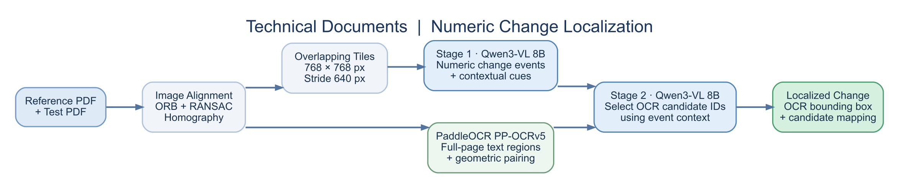
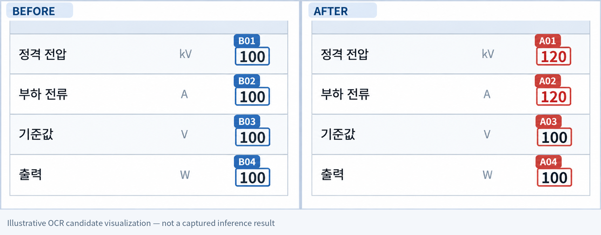

# KSMA Paper · 기술문서 수치 변경 위치 식별

### 경량 VLM 기반 기술문서 수치 변경 위치 식별

**같은 숫자가 반복되는 기술문서에서, 무엇이 바뀌었는지와 어디가 바뀌었는지를 함께 찾는 Document AI 연구.**

[English](README.en.md) · [연구 개요](paper/README.md) · [아키텍처](docs/ARCHITECTURE.md) · [평가 결과](docs/EVALUATION.md)

`Python` · `Qwen3-VL 8B Instruct` · `PaddleOCR / PP-OCRv5` · `OpenCV`

| Precision | Recall | OCR 단독 대비 Precision 향상 |
|:---:|:---:|:---:|
| **90.5%** | **100.0%** | **+66.2%p** |

*제공된 연구 자료에 기록된 위치 식별 평가 결과. 합성 문서 6쌍, 수치 변경 19개 기준이며, +66.2%p는 90.5% − 24.3%로 계산했습니다. [평가 구성 및 비교 결과 →](docs/EVALUATION.md)*

## Overview

**본 연구는** 기준 문서와 검사 문서를 비교해 수치 변경과 해당 문자 영역의 위치를 식별하는 연구 프로토타입입니다. 시험성적서와 같은 기술문서에서는 같은 숫자가 여러 항목에 나타나고, `100 → 120`처럼 동일한 변경쌍도 반복됩니다. 변경값을 찾는 것에 더해 **문서의 어느 항목에서 변경이 발생했는지** 연결하는 것이 핵심 과제입니다.

이 연구는 VLM의 문맥 이해와 OCR의 문자 영역 검출을 결합합니다. **1차 VLM이 변경 이벤트를 추출하고, 2차 VLM이 OCR 후보 ID를 선택**합니다. 최종 위치는 선택된 OCR Bounding Box의 좌표로 결정합니다.

## Key Contributions

| 핵심 설계 | 구현 방식 | 기술적 의미 |
|---|---|---|
| **2단계 VLM 추론** | 변경값·문맥 추출과 위치 후보 선택을 분리 | 의미 판단과 위치 식별의 역할을 명확하게 구성 |
| **OCR 좌표에 근거한 위치화** | 검출된 문자 영역에 후보 ID를 부여하고 VLM이 선택 | 최종 Bounding Box를 실제 검출 영역과 직접 연결 |
| **반복 변경쌍 구분** | 항목명·단위·상대 위치 등 주변 문맥 활용 | 동일한 변경값이 여러 곳에 나타나는 문제를 다룸 |
| **문서 정합과 국소 비교** | ORB·RANSAC 정합, 중첩 타일 비교 | 대응 영역을 공통 좌표계에서 비교 |

## System Architecture



**VLM은 변경 내용을 해석하고, OCR은 위치 후보를 제공하며, VLM은 문맥에 맞는 후보를 선택합니다.**

| 단계 | 처리 | 출력 |
|:---:|---|---|
| 1 | 기준·검사 문서의 ORB 특징점 및 RANSAC 호모그래피 정합 | 공통 좌표계의 문서쌍 |
| 2 | 768 × 768 px 타일, stride 640 px로 중첩 분할 | 대응 타일과 주변 문맥 |
| 3 | 1차 Qwen3-VL이 좌우 비교 영상 분석 | 변경 전후 값과 위치 단서 |
| 4 | 전체 페이지에 PaddleOCR 적용 및 기하학적 대응 | 문자 영역 Bounding Box와 후보 ID |
| 5 | 2차 Qwen3-VL이 변경 이벤트·문맥·ID 표시 영상 분석 | 변경 위치에 해당하는 후보 ID |
| 6 | 선택된 ID의 OCR 좌표 조회 | 최종 변경 영역 Bounding Box |

실험 구성은 300 DPI 렌더링, 페이지당 24개 대응 타일 위치를 사용합니다. OCR의 문자 영역 좌표를 후보로 활용하며, OCR 인식 문자열을 VLM의 최종 판단 입력으로 제공하지 않는 구조입니다. [단계별 설계 →](docs/ARCHITECTURE.md)

## Candidate Selection in Practice

예를 들어 정격 전압과 부하 전류가 모두 `100 → 120`으로 바뀌었다면, 변경값만으로 두 항목을 구분하기 어렵습니다. 1차 VLM이 각 항목의 문맥을 추출하고, 2차 VLM이 해당 문맥과 OCR 후보 ID를 연결해 **각 변경 이벤트의 위치를 따로 식별**합니다.



*후보 선택 원리를 설명하는 예시 그림입니다.*

## Evaluation

평가 대상은 **수치 변경의 존재 여부가 아니라 변경된 문자 영역의 위치 식별**입니다.

| 평가 항목 | 구성 |
|---|---|
| 문서쌍 | 합성 문서 6쌍 |
| 변경 조건 | 변경 문서 4쌍·수치 변경 19개, 무변경 문서 2쌍 |
| 문서 구조 | 표, 다중 영역, 본문과 표의 혼합, 그림 주변 수치 |
| 제안 기법 | Precision **90.5%** · Recall **100.0%** |
| OCR 단독 기준선 | Precision 24.3% · Recall 89.5% |
| 기준선 대비 차이 | Precision **+66.2%p** · Recall **+10.5%p** |

위 수치는 제공된 연구 자료에 보고된 해당 평가 세트의 결과입니다. 비교 실험 전체와 지표 정의는 [EVALUATION.md](docs/EVALUATION.md)에 정리했습니다.

## Technology Stack

| 영역 | 기술 |
|---|---|
| 시각·언어 추론 | Qwen3-VL 8B Instruct |
| 문자 영역 검출 | PaddleOCR / PP-OCRv5 |
| 문서 정합·영상 처리 | OpenCV, ORB, RANSAC, Homography, NumPy |

## Research

**국문 제목** · 기술문서의 수치 변조 위치 식별을 위한 경량 VLM 기반 OCR 후보 선택 기법  
**영문 설명** · VLM-Guided OCR Candidate Selection for Numeric Change Localization in Technical Documents  
**저자** · 김동규, 김병욱  
**소속** · 국립창원대학교 정보통신공학과

[연구 초록 →](paper/README.md)

**Acknowledgment**

This research was supported by the ANCHOR program through the ANCHOR Center, Gyeongsangnam-do, funded by the Ministry of Education (MOE) and the Gyeongsangnam-do Provincial Government, Republic of Korea (2026-ANCHOR-16-002).

## Repository Guide

이 저장소는 연구 설계와 보고된 성능를 소개하는 **기술 포트폴리오**입니다. 공개 자료는 연구 설명과 도식으로 구성되어 있습니다.

```text
KSMA_Paper/
├── README.md                 # 한국어 연구 소개
├── README.en.md              # English overview
├── assets/                   # 아키텍처·후보 선택 도식
│   ├── architecture.png
│   └── ...                   # SVG 및 Graphviz 원본 포함
├── docs/
│   ├── ARCHITECTURE.md        # 파이프라인과 설계 근거
│   └── EVALUATION.md          # 평가 조건과 비교 결과
└── paper/
    └── README.md             # 연구 초록과 저자 정보
```
