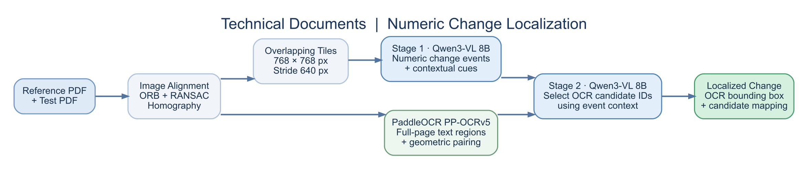

# System Architecture

## 1. Engineering Objective

목표는 **수치 변경 검출**과 **실제 수정된 문자 영역의 위치 식별**을 연결하는 것입니다. 문서에 같은 `100`이 반복되거나 동일한 `100 → 120` 변경쌍이 두 곳 이상 존재할 때도, 어느 항목에서 변경이 발생했는지 개별 이벤트로 판단할 수 있어야 합니다.

제안 시스템은 VLM에 픽셀 좌표를 자유롭게 생성하도록 요구하는 대신, OCR이 검출한 문자 영역에 ID를 부여하고 **VLM이 해당 ID를 선택하는 방식**을 사용합니다.



## 2. End-to-End Processing

### Step 1 — Document Alignment

- **Inputs:** Reference document and test document, rendered into images.
- **Mechanism:** ORB descriptors → feature matching → RANSAC-based homography estimation.
- **Output:** Spatially aligned document pair.
- **Purpose:** 대응 측정 항목을 공통 좌표계로 비교하고 이후 후보를 기하학적으로 대응시키기 위해 정합을 수행합니다.

### Step 2 — Overlapping Tiling

| Parameter | Research configuration |
|---|---|
| Rendering resolution | 300 DPI |
| Tile size | 768 × 768 pixels |
| Stride | 640 pixels |
| Overlap (adjacent axis) | 128 pixels |
| Paired tile positions | 24 per page |
| VLM comparison image | Side-by-side reference and test tiles (1536 × 768 pixels before any model-specific preprocessing) |

공통 좌표계에서 대응되는 두 영역을 추출해 좌우로 결합합니다. 중첩은 경계에 걸친 숫자를 인접 타일에서 다시 볼 수 있도록 하기 위한 설계입니다.

### Step 3 — Stage-1 VLM: Change Extraction

- **Model:** Qwen3-VL 8B Instruct.
- **Input:** Side-by-side paired tile image + change-extraction instructions.
- **Information extracted:** Before/after values and spatial or semantic cues such as neighboring table labels, units, and relative positions.
- **Output role:** Semantic change events, not final numeric bounding boxes.

반복된 동일 변경쌍도 주변 항목과 공간적 위치 단서가 서로 다르면 구분해 기술할 수 있도록 설계했습니다. 이는 **행 번호를 반드시 출력한다**는 의미는 아니며, 타일에 표시된 문맥 범위에 따라 사용할 수 있는 단서가 달라집니다.

### Step 4 — OCR Spatial Candidate Generation

- **OCR stack:** PaddleOCR / PP-OCRv5.
- **Execution scope:** OCR is applied to both full document pages; candidate regions are then associated with tiles of interest.
- **Pairing:** Text regions are matched between reference/test pages using aligned spatial geometry.
- **Candidate identifiers:** Reference (`B...`) / Test (`A...`) IDs are used for model selection.
- **Design principle:** OCR-recognized strings are not supplied as the model's final decision input; text-region geometry is the primary OCR contribution.

### Step 5 — Stage-2 VLM: Candidate ID Selection

**Inputs** combine: (1) Stage-1 numeric change information, (2) contextual cues, and (3) an annotated visual containing OCR candidate IDs.

**Task**: Select the candidate pair corresponding to the actual change event. The same lightweight VLM architecture is used for both stages.

#### Conceptual example (not a raw model log)

```text
Event 1: 100 → 120; context: Rated voltage
Event 2: 100 → 120; context: Load current

OCR candidate pairs:
  B01 / A01  => Rated voltage region
  B02 / A02  => Load current region
  B03 / A03  => Reference-value region

Selected candidates:
  Event 1 => B01 / A01
  Event 2 => B02 / A02
```

**Key idea:** 같은 값의 변경이 두 차례 발생해도 각 이벤트를 독립적으로 위치화하는 것을 목표로 합니다.

### Step 6 — Bounding-Box Localization

2차 VLM이 선택한 ID로부터 해당 OCR 영역의 좌표를 참조합니다. 최종 출력은 **문서의 수치 변경 위치에 대응하는 Bounding Box**입니다.

## 3. Design Rationale

| Technical choice | Rationale |
|---|---|
| ORB + RANSAC alignment | 서로 다른 촬영·스캔 배치의 동일 항목을 비교할 기준 좌표계 확보 |
| Overlapping tiles | 큰 페이지에서 작은 수치 변경을 국소 영역 단위로 비교 |
| Stage-1 VLM | 단순 문자열 대조에서 얻기 어려운 주변 문맥 단서 추출 |
| OCR geometry as candidates | 문자 영역의 위치를 명시적인 검색·선택 후보로 제공 |
| Stage-2 VLM selection | 변경 이벤트의 의미와 실제 문자 위치를 ID 매핑으로 연결 |
