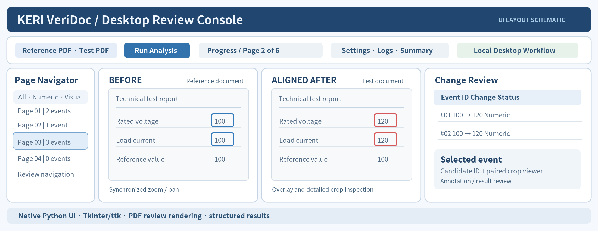

# Desktop GUI — KERI VeriDoc Review Console

## Overview

**KERI VeriDoc**의 관련 데스크톱 GUI 프로토타입은 분석 결과를 시각적으로 검토하는 데 초점을 둔 **Python Tkinter/ttk** 기반 애플리케이션입니다. 브라우저 기반 뷰어가 아니라 로컬 데스크톱 창에서 문서 선택, 결과 탐색, 비교 및 검토 작업을 수행하도록 구성했습니다.

> 위 도식은 실제 `keri_veridoc_desktop_gui_v0_10_review.py`의 화면 구성과 기능을 바탕으로 만든 **레이아웃 개념도**이며, 애플리케이션 실행 화면을 캡처한 것은 아닙니다.

## Workflow

### 1. Import and Run

- Reference PDF와 Test PDF를 각각 선택.
- 결과 Run ID, 분석 설정, 분석 실행/중지 기능.
- 작업 진행 표시 및 현재 처리 상태 확인.
- 실행 결과의 요약·로그·결과 폴더로 이동.

### 2. Navigate

- Run 선택 및 페이지 단위 결과 탐색.
- `전체 / Numeric / Visual` 필터를 이용한 페이지 목록 확인.
- 페이지별 변경 건수와 확인 대상 상태를 함께 제공.

### 3. Compare

- 중앙에 **BEFORE** 및 **ALIGNED AFTER** 문서 뷰어를 나란히 배치.
- 확대·이동, 뷰 동기화 등 검토 편의 기능.
- Numeric/Visual Bounding Box 표시 선택.
- 기준 문서와 정합된 검사 문서의 시각적 대조.

### 4. Review Each Event

- 변경 이벤트를 리스트 형태로 제시.
- 선택 이벤트의 판정·변경값·상세 설명 확인.
- 선택 영역의 BEFORE/AFTER crop을 별도의 비교 창에서 확대 조회.
- 리뷰 주석 데이터를 JSON 파일로 저장하는 기능을 포함.

## UI Layout

| Panel | Function |
|---|---|
| Header & Command bar | Document inputs, analysis control, progress, summary/log actions |
| Left navigator | Run/page selection and Numeric/Visual filtering |
| Center document viewers | Side-by-side BEFORE and ALIGNED AFTER review |
| Right change panel | Event list, detail explanation, selected-event inspection |
| Crop preview window | Synchronized enlarged BEFORE/AFTER view of a selected region |

## Implementation Notes

- **UI toolkit:** Python standard-library `tkinter` / `ttk`.
- **Rendering:** `pypdfium2` for PDF review rendering.
- **Imaging:** OpenCV, NumPy, Pillow.
- **Result model:** Structured JSON artifacts and per-run result directories.
- **Execution:** Local desktop orchestration. The related engine configuration may use a loopback Ollama service (`127.0.0.1`).

**Scope distinction:** 이 GUI는 관련 VeriDoc E2E 검토 도구이며, 논문의 6쌍 합성 데이터 실험과 동일한 실행 엔진을 사용했다는 의미는 아닙니다. GitHub 포트폴리오에서는 **문서 분석 파이프라인과 검토 인터페이스라는 두 가지 엔지니어링 성과**로 각각 소개합니다.
